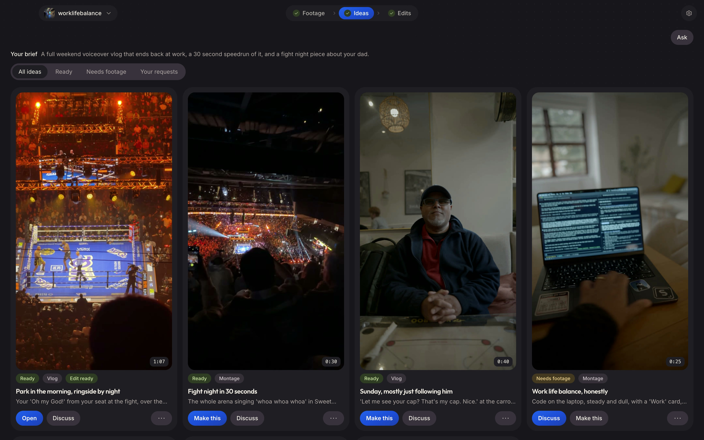
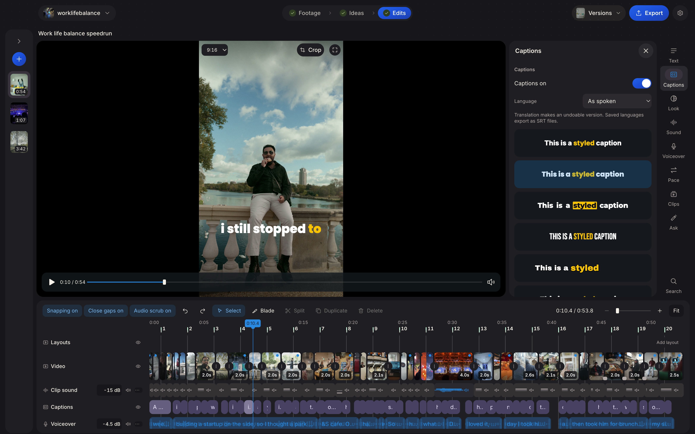
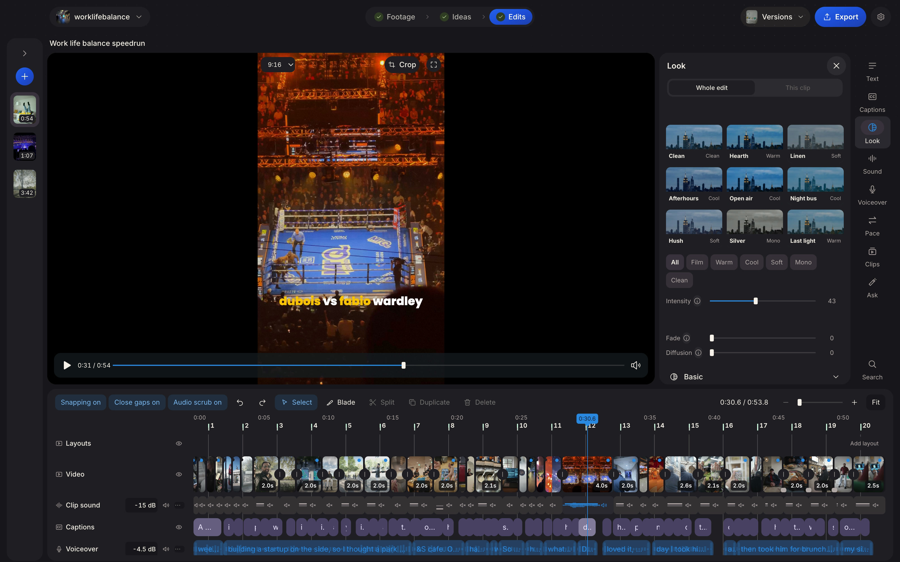
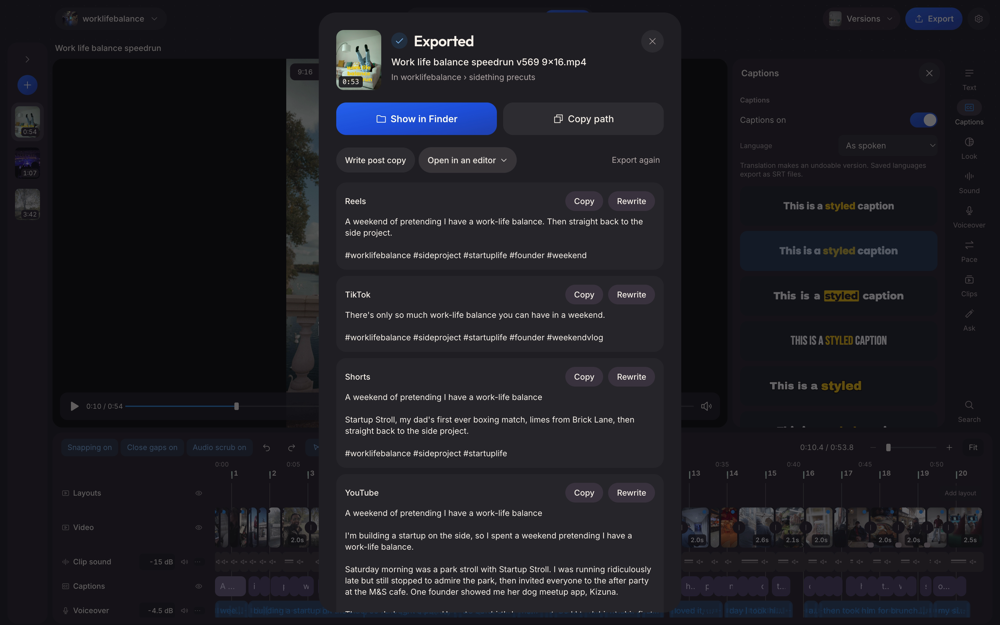

# precut

precut turns a folder of raw footage into first edits for short videos. Point it at a shoot. It reads every clip, transcribes what you said, finds the takes worth keeping, suggests ideas and cuts edits you can trim, caption, grade and export. You stay in charge of every cut.

precut is made by sidething and is free software under the GNU AGPL, version 3.









## Start in a minute

1. Download `precut.dmg` from [Releases](https://github.com/alimzysworld/precut/releases), open it and drag precut into Applications. It is signed with sidething's Developer ID and notarised by Apple.
2. Open precut. Pick the AI you already use, Claude Code or Codex, or press Start without AI. You can add one any time.
3. While you go through setup, precut downloads its video tools (1.4 GB) and speech model (1.6 GB) in the background, once.
4. Press Add shoot and choose a folder of clips. precut reads them, then shows ideas and first edits.
5. Open an edit, change what you like, and press Export.

No AI yet? You can still add a shoot, read every transcript, build an edit by hand from Footage (Add to edit) and export it. Ideas, automatic edits, Ask and post copy need an AI.

precut updates itself from this repo's releases. When a newer version is ready, the top bar says "Update ready: restarts when you quit". It installs when you quit precut, after every change you made is saved. Settings, General, has "Check for updates automatically" and "Check for updates".

## What you need

- A Mac with Apple silicon (M1 or newer). Intel Macs are not supported.
- macOS 14 Sonoma or newer. precut's speech packages (mlx) need macOS 14, so the app won't open on anything older.
- 16 GB of memory is comfortable. precut used about 3.5 GB at its busiest while transcribing a first shoot.
- About 4 GB free for precut itself: the app and its tools and speech model. Each shoot also keeps previews and transcripts in a hidden `.sidething` folder inside it, about a fifth of the footage's size.
- An internet connection for the first launch. After that, footage processing runs on your Mac.
- For ideas and automatic edits: Claude Code signed in with a Claude subscription, or Codex signed in with ChatGPT. precut uses your own plan; it has no account or server of its own.

## What stays on your Mac and what leaves it

**Stays on your Mac.** Your footage, audio and photos are never uploaded. Reading clips, transcribing speech (the speech model runs on your Mac), previews, looks, sound, editing and exporting all run here.

**Goes to the AI you picked.** precut asks Claude Code or Codex, through its own app on your Mac, which sends it to Anthropic or OpenAI under your plan:

- transcripts of your clips, with word timings;
- clip, folder and shoot names, your notes, brief, skills and words to spell right;
- edit plans and measurements (lengths, sound levels, shake, colour);
- small still frames and contact sheets from your footage, while **AI sees frames** is on (Settings, Privacy). Turn it off and no picture goes to the AI: precut judges takes, writes ideas and cuts edits from transcripts and measurements alone, and anything that needs to see a shot says so.

precut asks Claude Code not to save its requests (`--no-session-persistence`) and Codex not to either (`--ephemeral`), so they don't pile up in `~/.claude` or `~/.codex`. Ask is a terminal you open yourself inside precut: like any session you start, Claude Code keeps it in `~/.claude` and Codex in `~/.codex`.

**Other connections.**

- First launch: Python from GitHub, Python packages from PyPI and the speech model from Hugging Face. Every package and the model are pinned to the exact versions precut is tested with.
- Update checks: this repo's GitHub releases, about every six hours. Turn off "Check for updates automatically" in Settings, General, and precut only checks when you press Check for updates.
- ElevenLabs, only if you connect your own key to make sound effects. It receives the words describing the sound. The key is stored in your Mac's keychain.
- Add-ons you choose to install in Settings, Add-ons, from the sites listed there.

precut sends nothing to sidething. There is no account, no analytics and no crash upload. Errors are written to a log on your Mac only.

## Where files go

- Your edits, previews and transcripts: a hidden `.sidething` folder inside each shoot folder. Paths to files inside the shoot are saved relative to it, so a moved shoot keeps working once you relink it.
- Exports: a `sidething precuts` folder inside each shoot folder, or the folder you choose in Settings.
- Settings, the tools, the speech model and Python's caches (`py-cache`): `~/Library/Application Support/precut`.

## Uninstall

1. Quit precut and drag it from Applications to the Bin.
2. Delete `~/Library/Application Support/precut` (tools, speech model, caches, settings and the log).
3. Optionally delete these too, if they exist: `~/Library/Caches/com.sidething.precut`, `~/Library/Preferences/com.sidething.precut.plist`, `~/Library/Saved Application State/com.sidething.precut.savedState`, and `~/.local/bin/precut` (only there if you installed the command-line tool).
4. Your shoots keep their `.sidething` folders and exports. Delete a shoot's `.sidething` folder to remove precut's work on it; your original clips are never changed.
5. In System Settings, Privacy and Security, you can remove precut from Microphone, Speech Recognition and Automation.

## Known limits

- Speech is transcribed as English.
- The first shoot waits for the speech model if the download has not finished.
- Remove music and Isolate voice need the Sound separation add-on, which needs macOS 26. Without it, voice clean-up uses precut's built-in model.

## Build from source

On an Apple silicon Mac with Node.js 22 or newer and the Xcode command line tools (`xcode-select --install`):

```sh
npm ci
npm run fetch-tools   # builds ffmpeg and ffprobe from pinned source, downloads uv and ExifTool (pinned by hash), compiles the Swift helpers
npm run typecheck
npm run build
npx electron-builder --mac dir --arm64 --publish never
node scripts/check-bundle.mjs dist.noindex/mac-arm64/precut.app   # every helper and licence text is in the bundle
```

Release builds (Developer ID, hardened runtime, notarised) are made with `scripts/release-mac.sh`; it needs sidething's signing identity and notary profile.

## Licence

precut is licensed under the GNU Affero General Public License, version 3 only. See [`LICENSE`](LICENSE). The tools, libraries, fonts and sounds it ships keep their own licences: see [`resources/licenses/THIRD-PARTY-NOTICES.md`](resources/licenses/THIRD-PARTY-NOTICES.md), including where to get the source of the bundled ffmpeg. Every licence text is in `resources/licenses/` and in the app, under Settings, About, Licences.
